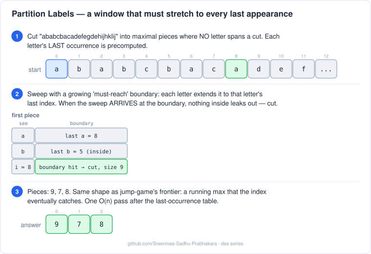

# Partition Labels

> NeetCode 150 · Greedy — each letter obligates its piece to reach that letter's last occurrence; cut exactly where the scan catches up with the furthest obligation. Go, stdlib only, tested.

## Problem

Split a string into as many pieces as possible so that no letter spans two pieces; return the piece lengths. `"ababcbacadefegdehijhklij"` → 9, 7, 8.

## Approach

Precompute every letter's last occurrence. Scanning left to right, a piece's required end is the max of the last-occurrences of the letters seen so far in it — an obligation that only grows. When the scan index *equals* that obligation, nothing inside points beyond it: the piece is closeable, and closing at the earliest legal moment is what maximizes the piece count (any later cut merely merges pieces). This is interval merging in disguise — each letter is the interval [first, last], and pieces are the merged clusters — compressed into one pass with two integers.

**Complexity:** O(n) time, O(26) space.

## Visual walkthrough

Read the picture top to bottom — each numbered frame is one moment of the algorithm
running on this repo's test example.

## Run

    go test ./...   # verify
    go run .        # demo

---

Part of a 275-repo DSA series in Go — Striver's SDE Sheet (dsa-001–191) plus the NeetCode 150 / Blind 75 additions (dsa-192–275), stdlib only, every solution tested. Browse: [`dsa-*` repos](https://github.com/Sreenivas-Sadhu-Prabhakara?tab=repositories&q=dsa-&type=source).
